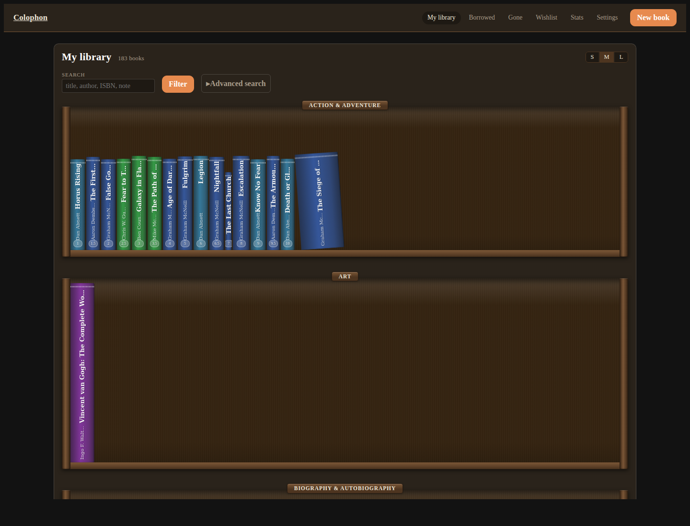
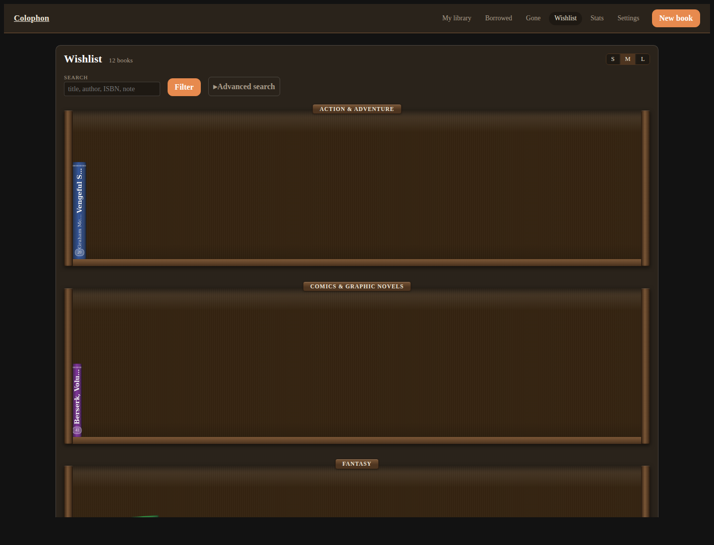
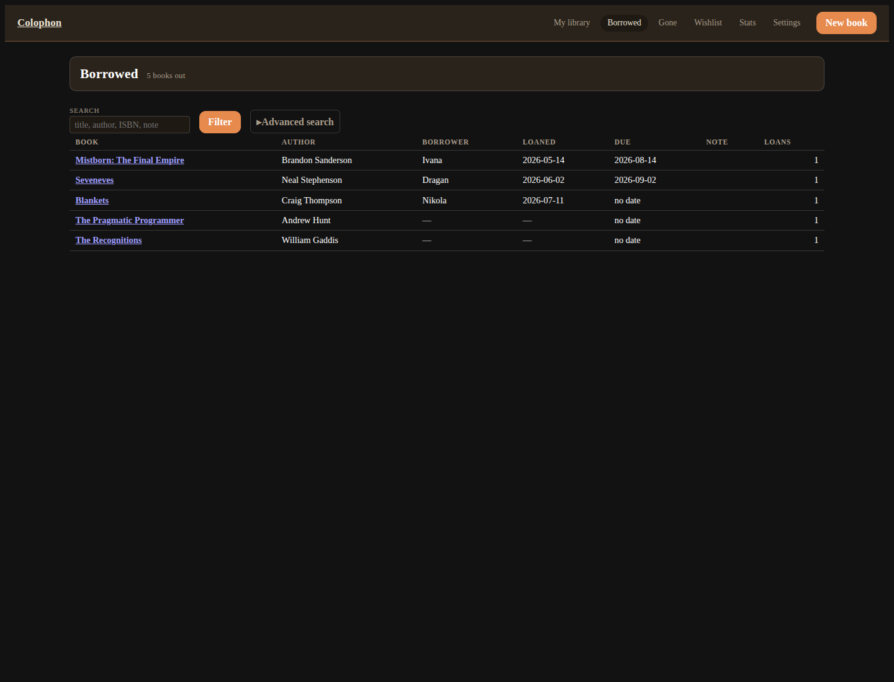
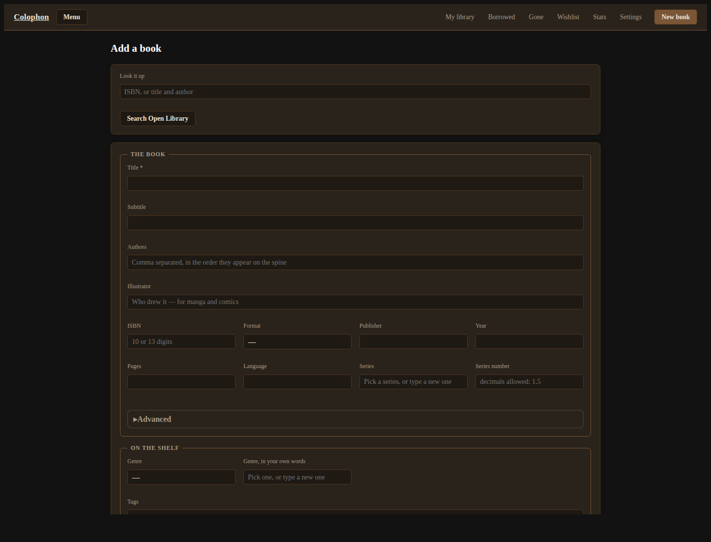
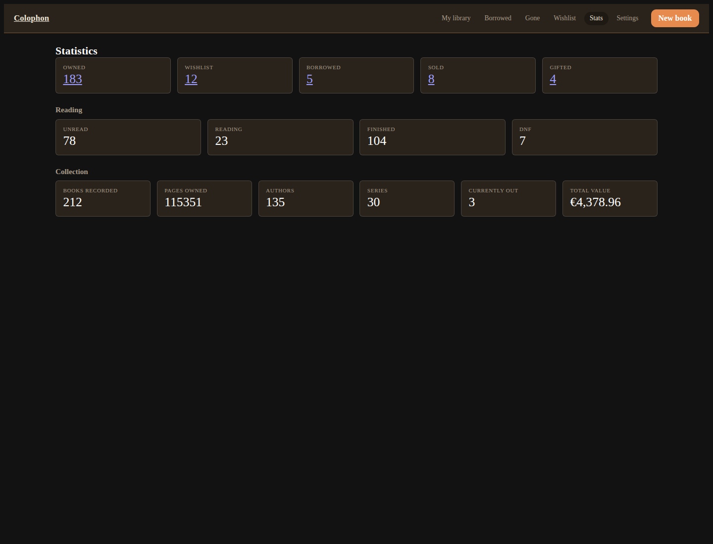

# Colophon 📚

**Colophon** is a self-hosted catalog for a personal library of **physical** books. What you own, what
you want, what you lent out, what you sold or gave away — kept on shelves that look like real wooden
shelves, with spines drawn at true proportions and full publishing metadata behind every book.

Open source, free to use and modify as you wish. Fully local.



## 🌟 Key Features

For a complete, categorized list of every feature, see the [Full Feature List](FEATURES.md).

Real-looking wooden shelves, search that covers everything, and publishing data you'd expect from a book
shop — all on your own machine.

### 📚 Library & Catalog
Catalog every aspect of a physical book — authors, series, publisher, ISBN, page count, language,
condition, and more.

- **Complete metadata**: title, subtitle, authors, illustrator, translator, editor, edition, ISBN,
  format, publisher, publication & print year, pages, language, original title & language.
- **Series**: pick an existing series or type a new one; a position lets you order books *within* the run.
- **Rich condition tracking**: a 1–5 condition rating, price, where bought, signed and sprayed-edge flags,
  and free-form notes/inscriptions.
- **Autofill everywhere**: Authors, Illustrator, Translator, Editor, Series, Tags and the free-text genre
  all offer a dropdown of what you've already used — but still accept a brand-new value.

### 🗄️ Shelves
Four shelves map the life of a book in your hands.

- **My library** — what you own, drawn on wooden shelves with true-to-mm spine widths and cloth colors.
- **Wishlist** — books you want.
- **Borrowed** — what's out on loan, to whom and since when.
- **Gone** — what you sold or gave away, with the to-whom and price.
- **Zoom presets** (S / M / L) and flip-to-cover on every spine.



### 🔍 Search & Filters
One search box plus a powerful Advanced panel.

- **Full-text search** across title, author, ISBN, notes and more (SQLite FTS).
- **Advanced filters**: author, tag, genre, year, reading state, room, and a *search scope* toggle that
  can also cover gone & borrowed books.



### ➕ Add & Lookup
Add a book in seconds.

- **Lookup**: type an ISBN or a title+author and Colophon fills the form from Open Library, Google Books or ISBNdb.
- **Manual entry**: every detail is optional; the shelf still draws a realistic spine either way.
- **Photos**: upload, crop, and EXIF are stripped on save; a provider cover is cached automatically.



### 📊 Statistics, Export & Data
Know your library and take it with you.

- **Statistics** page — owned / wishlist / borrowed / sold / gifted counts, reading states, total value.
- **Export** to CSV or JSON, honouring the current filters.
- **Backup** — scripts/nightly-backup.sh snapshots the SQLite database and uploads.



### 🔐 Accounts & Settings
- **Real login**, HTTP-only sessions with a sliding expiry, CSRF on every mutation, and IP+user lockout.
- **Settings** for theme (light/dark), shelf zoom, date/time and currency formats.

## 🚀 Quickstart

Requires Python 3.12+ and SQLite.

```sh
make venv && make migrate && make dev
```

Then open <http://localhost:8000>. `make dev` runs a single-worker uvicorn with reload and sets
`COLOPHON_DEV_AUTH_BYPASS=1`, so no login is required during development. `make serve` runs the same server
with **login required** — that's what you run to use the app for real. Both listen on `0.0.0.0`, so other
devices on your network can open it at `http://<this-machine's-lan-ip>:8000`.

The demo account is `demo` / `demo` until you change it in **Settings**.

## 🛠️ Commands

| Target | What it does |
|---|---|
| `make venv` | Create `.venv` and install pinned runtime + dev dependencies |
| `make dev` | Dev server on `0.0.0.0:8000`, reload on, auth bypassed |
| `make serve` | Same server with **login required** — run this to use the app |
| `make seed` | (Re)build the demo user's 210-book fixture library |
| `make test` | `pytest -q` |
| `make lint` | `ruff check .` |
| `make fmt` | `ruff format .` |
| `make migrate` | `alembic upgrade head` |

Everything the app stores lives under `data/` — the SQLite file, `data/bisac.json` (BISAC genre data) and
`data/photos/` (uploaded images). That directory is the container volume mount; it is gitignored, and
deleting it deletes your library, so back it up first.

Container alternative: `docker compose up --build` (SQLite file and uploads live in the `colophon-data`
volume; env vars are documented in `docker-compose.yml`).

## ⚙️ Environment

All variables are optional in development:

| Variable | Purpose |
|---|---|
| `COLOPHON_DB_PATH` | SQLite file path (default `data/colophon.sqlite3`) |
| `COLOPHON_UPLOAD_DIR` | Uploaded photos directory (default `data/photos/`) |
| `COLOPHON_COOKIE_SECURE` | `1` marks session cookies Secure (HTTPS-only) — set this on any TLS deployment |
| `COLOPHON_BACKUP_DIR` | Backup output directory (default `data/backups/`) |
| `COLOPHON_DEV_AUTH_BYPASS` | `1` skips login — development only, never on a public host |

Search keys are **per reader, not per install**: Open Library needs no key, while Google Books and
ISBNdb are keyed with each reader's own key, pasted in **Settings → Search providers**. There is no
server-side key env var, and enabling a keyed provider without its key is refused on that page.

## 🌍 Putting it on the public internet

The app is built for this and nothing else needs to change in code: login is required everywhere, there
is **no public signup** — accounts exist only because the admin created them in **Settings → Create a
user** — and sessions, CSRF, login throttling and the security headers are on by default. What is yours
to do:

1. **TLS.** Put a reverse proxy (nginx, Caddy) in front and set `COLOPHON_COOKIE_SECURE=1` so session
   cookies only ever travel over HTTPS. uvicorn already runs with `--proxy-headers`; set
   `FORWARDED_ALLOW_IPS` to your proxy's address so the per-IP login lockout keys on real client IPs
   rather than the proxy's (otherwise one attacker can lock *every* reader out with five bad logins).
2. **Never deploy with the dev bypass.** `COLOPHON_DEV_AUTH_BYPASS=1` (which `make dev` sets) disables
   login entirely. `make serve` and the Docker image never set it — keep it that way.
3. **Change the seeded passwords.** The bootstrap admin and demo accounts are flagged by an in-app
   banner until their passwords change. Delete the demo user in Settings when you do not need it; the
   login screen only advertises demo credentials while a default-password demo account exists.
4. **Accounts are invite-only.** There is no signup route; the admin creates readers in Settings and
   deleting a reader there removes their books, photos and sessions with the account.
5. **Back up `data/`.** `scripts/nightly-backup.sh` snapshots the SQLite file and photos with 30-day
   retention. Deleting `data/` deletes the library.

The hardening contracts behind this list are pinned by `tests/hardening/` (auth and invite-only
invariants, upload and export containment, SSRF/egress bounds, injection probes, headers and process
flags) — if one of these ever regresses, `make test` fails loudly.

## 🧱 Tech

- **Backend**: FastAPI + SQLAlchemy (`text()` SQL) + Alembic migrations
- **Frontend**: Jinja2 server-rendered templates + a little vanilla JS. No SPA, no bundler, no framework CSS.
- **Data**: SQLite (WAL), FTS5 full-text search
- **Tests**: pytest — 400+ tests, green

## ❌ What this is **not**

This is **not an e-book reader**. Colophon handles physical books only — no e-books, no audiobooks, no
reading functionality of any kind. It is also **not a social network**: the only publicly visible page is
the login screen.

## 📄 License

AGPL-3.0-only — see [LICENSE](LICENSE).
